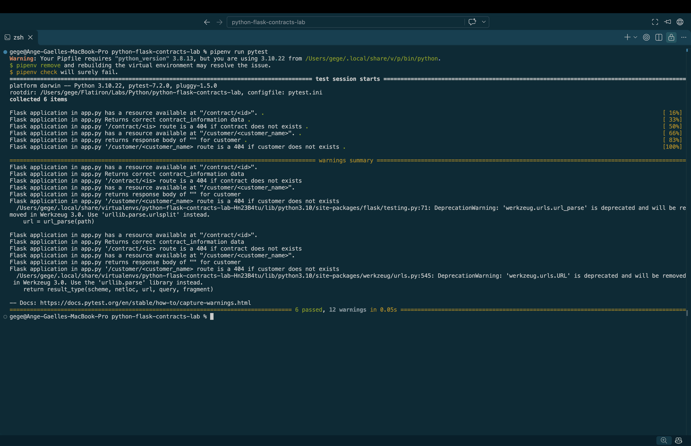

# Flask Routes: Managing Contracts

## Description

This project is a Flask web application. The application demonstrates how Flask handles HTTP requests and responses using dynamic routes and HTTP status codes.

Users can retrieve contract information by ID or check whether a customer exists.

## Technologies Used

- Python 3.10
- Flask
- Pipenv
- Pytest

## Installation

1. Clone the repository:

   ```bash
   git clone git@github.com:a-gbatie/python-flask-contracts-lab.git
   ```

2. Navigate into the project directory:

   ```bash
   cd python-flask-contracts-lab
   ```

3. Install the dependencies using Python 3.10:

   ```bash
   pipenv install --python 3.10
   ```

## Running the Application

Start the Flask server:

```bash
pipenv run python server/app.py
```

The application runs at:

http://127.0.0.1:5555/

## API Routes

### GET `/contract/<id>`

Retrieves contract information using a contract ID.

If the contract exists, the application returns its information with HTTP status `200 OK`.

**Example Request:**

```text
GET http://127.0.0.1:5555/contract/1
```

**Response:**

```text
This contract is for John and building a shed
```

**Status:** `200 OK`

If the contract does not exist:

```text
GET http://127.0.0.1:5555/contract/99
```

**Response:**

```text
Contract not found
```

**Status:** `404 Not Found`

### GET `/customer/<customer_name>`

Checks whether a customer exists in the customer list.

If the customer exists, the application returns HTTP status `204 No Content`.

**Example Request:**

```text
GET http://127.0.0.1:5555/customer/bob
```

**Response:** No content

**Status:** `204 No Content`

If the customer does not exist:

```text
GET http://127.0.0.1:5555/customer/alice
```

**Response:**

```text
Customer not found
```

**Status:** `404 Not Found`

## HTTP Status Codes

This project demonstrates three HTTP status codes:

| Status Code | Meaning | Usage |
|-------------|---------|-------|
| 200 | OK | Contract was found |
| 204 | No Content | Customer exists, but no data is returned |
| 404 | Not Found | Contract or customer does not exist |

## How It Works

The application uses Flask's `@app.route()` decorator to connect URLs to Python functions.

### Contract Route

The contract route uses a dynamic integer parameter to identify a contract.

A `for` loop searches through the `contracts` list and checks whether the requested ID matches an existing contract.

If a match is found, the contract information is returned with status `200`.

Otherwise, the application returns status `404`.

### Customer Route

The customer route captures a customer's name from the URL.

An `if` statement checks whether the name exists in the `customers` list.

If the customer exists, the application returns status `204` with an empty response body.

Otherwise, it returns status `404`.

## Testing

Run the automated tests:

```bash
pipenv run pytest
```

The tests check whether the routes return the expected responses and HTTP status codes.

## Screenshot of Completed Tests
